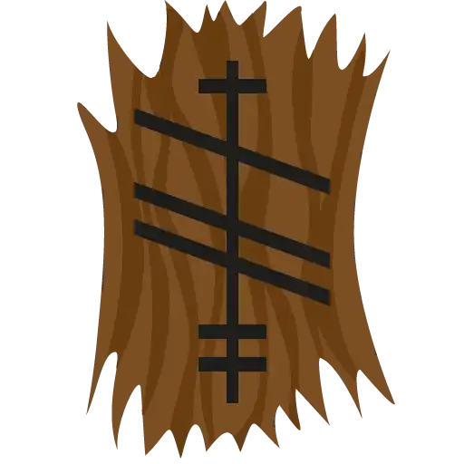

# Ogma
## A reflection-based, scope-based C++26 argument parser



Ogma is a compile-time argument parser built on top of C++26 static reflection and annotations. It is inspired by
Rust's Clap derive API, so there is no separate schema, no builder, no runtime registration step, and no generated
code to check. The command line is described by an ordinary struct with a few annotated members, and reflection is
what lets Ogma read that description directly off the struct instead of asking you to restate it somewhere else.
Named after the Celtic god of eloquence, knowledge, and writing, Ogma takes the position that a declaration should
be allowed to speak for itself.

Before anything else, this is the most idiosyncratic library from my "pantheon project". It does not parse arguments
the standard way, and the sections below explain why the standard way was rejected.

> **Status:** early development, tested on GCC 16 (experimental reflection). See [Requirements](#requirements).

## The big rule, nobody is special

There is exactly one special type in Ogma and it is `std::optional`. Everything else follows the same two questions.
How can this member be invoked, by a bare token, by its flag, or only by its flag? And is it required? Required means
the member must be filled, either because a bare token reached it (positional) or because its flag was typed. The
only escape is `std::optional`, which is also the only type that can be left unset. The details live in
[Positional vs named](docs/PositionalVsNamed.md).

This rule is what keeps the library small. There are no global arguments, no special-case booleans, no help text
stored anywhere in the grammar. `--help` and `--version` are intercepted before any member lookup, and their names
are reserved at compile time, so no member can ever claim them. That is the entire machinery behind the free help,
two flags and two compile-time checks.

Every annotated member goes through the same path. The engine builds two compile-time tables for each struct, the
named flags and the positional queue, and every member enters them through the same contract. A `bool` is not
special-cased anywhere in the engine, it is a regular `TypeParser<bool>` specialization that happens to consume
nothing and to generate a `--no-name` spelling. When a parser is that transparent, nothing needs a footnote.

## Tree traversal instead of flatten

In almost every popular library nested classes are treated with flattening. Some solve conflicts with namespaces,
others just guarantee that there is no name collision, and some ignore that this can happen, but the general idea is
the same. There is no idea of scopes, it is a linked list of options with no hierarchy or boundaries. This dates
back to ancient times, and I personally have not been able to find out when it became the rule or if anyone has ever
questioned it. (Nearly) every argument-parsing library, in nearly every language (even Haskell!!), takes this path.

It works like this. Take a sub-options struct, promote its fields straight into the parent's own namespace, and
parse the whole thing as one flat bag of flags. Even parsers built in languages that otherwise go out of their way
to avoid this kind of implicit merging take this path. It offers less resistance once you have two levels of options
and one flag namespace to put them in. Even when the library uses namespaces (so `--host-port` does not collide with
`--target-port`), they still read like a flat bag of flags.

Subcommands are the only thing that normally introduces the concept of scopes. When you enter a subcommand, you do
not leave anymore. Every option is now part of the subcommand's namespace and does not affect the parent flags.

Ok, it is practical, everyone is used to it, but I do not like it.

### How Ogma does it

Every level of an Ogma struct is parsed recursively through the primary `TypeParser<T>` template, so there is no bag
of flags. A struct with no specialization IS the struct-walking engine, and that is the same engine at the root and
at every nested level. There is no separate dispatch for nested members, an annotated struct member simply reaches
`TypeParser<FieldT>::Parse` like any other member, and the engine handles it the same way it handles the root. The
extension contract is documented in [TypeParser](docs/TypeParser.md).

Scopes are explicit on both sides. You enter one by typing the member's flag (`--inner`), or the subcommand's bare
name. You leave one with `-`, which ends exactly one level of nesting and hands the remaining arguments back to the
parent. This is what "explicit enter, explicit exit" buys. A nested struct never has to invent a subcommand name
just to exist, and two structs anywhere in the tree can each declare a field with the same name without either one
ever knowing about the other, with no namespaces. The full rules live in [Scopes](docs/Scopes.md).

### Is flatten bad?

No. Ogma is a deliberate, opinionated choice, and the honest reason it exists is closer to "I like recursion and
trees" than to any problem flatten failed to solve. As I said earlier, there are ways to solve the naming conflict
problem using flattening, but I just chose to refuse to implement it.

Despite being vulnerable to naming collisions (in the basic form), there is another class of ambiguities that
flattening solves by simply merging all the structs into one namespace. You do not need to exit from a scope because
you can only enter subcommands, but they do not let you leave them. No exiting from a namespace means no need to
know when to stop parsing and return to the parent. Ogma needs explicit enter and explicit exit for subcommands and
nested classes alike, see [Scopes](docs/Scopes.md).

Tree-shaped parsing does buy something real in return. It will probably feel backwards before it feels natural,
whether that trade is worth it is a matter of taste as much as engineering (fair reaction, the ceremony that flatten
simply does not ask for). However, it gets easier to read once the boundary stops feeling surprising.

## Subcommands

A `VariantArg` member declares a variant-backed subcommand. A bare token naming one of the declared cases opens the
branch, which then owns every following token exactly like any other scope, until `-` closes it or the arguments end.

```cpp
inline constexpr Ogma::VariantArg::VariantBranch kCommands[] = {
    { "compress", "Compress files." },
    { "extract" , "Extract files."  }
};

struct [[ =Ogma::AppInfo{ "filetool", "1.0.0", "A file archiver." } ]] App {
    [[ =Ogma::VariantArg{ kCommands, std::size(kCommands) } ]]
    std::variant<Compress, Extract> command;
};
```

A subcommand is not reachable through a `--` spelling, `--compress` is nobody's flag, and the prefix is exactly what
keeps the flag namespace and the subcommand namespace separate. Flags of the parent are read before the dispatch, so
`app --verbose compress` works and `app compress --verbose` fails if `--verbose` belongs to the parent.

A branch is a full engine, not a special mode. Inside it, bare tokens fill positional members, its own flags answer,
nested structs open their own scopes, and `-` closes it. One dispatch per struct, and the command member must be the
last annotated member of its struct (bare tokens fill positional members in declaration order, so anything declared
after the subcommand would never be reachable by position).

## Structural positionals

Some types are positional and can have their flag omitted (the argument is deduced by position), and others can only
be specified by naming them, to reduce ambiguity. The default engine needs the name to know which member to enter,
the same way it needs the subcommand's bare name. But a string can be positional, because reading a string is a
simple task. The full protocol lives in [Positional vs named](docs/PositionalVsNamed.md).

```cpp
// "name" can be deduced by both "--name abracadabra --no-bind" and "abracadabra --no-bind", because `name`
// does not need its flag to know that "abracadabra" is related to it, but "--bind" can only define a
// value for `bind` because their flag was specified.
struct Example1 {
    [[ =Ogma::Arg{ "name" } ]] std::string name;
    [[ =Ogma::Arg{ "bind" }, =Ogma::boolArg ]] bool bind;
};

// This cannot be deduced by "--name abracadabra --no-bind -- 5", because from a logic perspective "--name"
// could be a flag from Example1 (omitting the flag for `child` itself) or a mistyped flag from Example2.
// It needs to be "--child --name abracadabra --no-bind -- 5".
struct Example2 {
    [[ =Ogma::Arg{ "child" } ]] Example1 child;
    [[ =Ogma::Arg{ "value" } ]] int      value;
};
```

Since `rawHuman` and `unixTime` below are positional, a `--raw` flag typed on the command line could plausibly
belong to either `ChronoOptions` itself or to `rawHuman`. There is no selector word to tell them apart, unlike a
`VariantArg` subcommand. Rather than flatten the two structs into one namespace (which would make `--raw` collide
with anything else named `raw` anywhere in the tree) or invent a prefixed spelling like `--raw-human-raw`, the
closing token is what marks the boundary.

```text
--raw 500 --human 1s - --seconds 2 --milliseconds 2500
```

The same explicit boundary is what makes a repeated structural positional possible. A `std::vector<RawHumanOptions>`
parses one `RawHumanOptions` per element, each one closed by its own `-`. Omitting the boundary between two elements
is read as repeated options for the current element, not as the start of a new one. The `-` is what draws the line,
not position.

## Annotations

Annotations are the mechanism that lets a declaration carry intent. Plain reflection only sees the shape of a struct,
names, types, default values. It will never know that `downloadVideos` should also answer to `--videos`, or that a
field is constrained to a range, or which text to show in the help. That is intent, and annotations
(`[[ =expr ]]`, from [P3394](https://wg21.link/p3394)) attach it directly to the field, instead of into a parallel
table.

| Annotation                                                    | Purpose                                                                                                 |
|---------------------------------------------------------------|---------------------------------------------------------------------------------------------------------|
| `Arg`                                                         | Gives a member its long option name, description and hidden state.                                      |
| `VariantArg`                                                  | Describes the branches of a variant-backed subcommand.                                                  |
| `AppInfo`                                                     | Metadata (name, version, description) for the root application type.                                    |
| `BoolArg`                                                     | Makes a `bool` member consume an explicit "true"/"false" value. Without it, a bool is an on/off switch. |
| `Alias`                                                       | Adds an alternative spelling to an enum enumerator.                                                     |
| `CaseInsensitive`                                             | Makes enum matching ignore letter case.                                                                 |
| `MustExist`, `FileOnly`, `DirOnly`                            | Validate filesystem paths.                                                                              |
| `Range`, `FRange`                                             | Constrain an integral or floating-point value to an inclusive range.                                    |
| `IntegerFmt` (`hexNumber`, `binNumber`, `siNumber`)           | Accept hexadecimal, binary, or SI-suffixed integers.                                                    |
| `FloatFmt` (`siFloat`)                                        | Accepts SI-suffixed floats.                                                                             |
| `DurationFmt`                                                 | Enables human-readable duration parsing (`1s 250ms`, ...).                                              |
| `TimePointFmt` (`iso8601`, `unixSeconds`, `unixMilliseconds`) | Selects the wire format for a time point.                                                               |
| `Overwrite`                                                   | Makes a repeated container option replace its contents instead of accumulating.                         |
| `Fwd<...>`                                                    | Forwards annotation values to the elements of a container member.                                       |

`Arg::description` is the member's prose in the help page. The parser's own modifiers (`[format: hex]`,
`[range: 0..100]`) are appended after it automatically, and `Arg::hidden` removes the member from the page entirely.

## Help

Every page is rendered from the same annotations that drive parsing, so the page and the parser cannot drift apart. 
`--help` answers at every scope, showing the page of the scope you are in (`app --help` shows the root, 
`app compress --help` shows the branch), and `--version` answers at the root when `AppInfo` is declared. The page 
anatomy, the usage grammar and the modifiers are detailed in @ref help-page "Help".

The page is plain text, with no ANSI escapes, so it is safe to pipe, diff and parse. Styling, if you want any,
happens at the printing boundary, on your side of the library.

## Error messages

Errors chain from the outside in one context prefix per scope crossed. A leaf owns the "what" (`invalid number: 'abc'`), 
the engine owns the "where".

```text
error: serve: --retries: invalid number: 'abc'
```

Missing required members are reported together, one line each, and a missing subcommand lists every accepted case.

## Requirements

- Windows 10 or newer / Linux
- A compiler with C++26 static reflection ([P2996](https://wg21.link/p2996)) and annotations
  ([P3394](https://wg21.link/p3394)) support, tested on GCC 16 with `-freflection`
- CMake 3.29 or newer

## Installation

### CPM

```cmake
CPMAddPackage(
        NAME Ogma
        GITHUB_REPOSITORY NotRiemannCousin/Ogma
        GIT_TAG main
)

target_link_libraries(your_target PRIVATE Ogma)
```

## What Ogma deliberately does not have

Some absences are design decisions, and they are listed here so they are not mistaken for gaps.

- **No short flags.** There is no `-v` and never a packed `-cve`. `-` is the closing token, and giving single-dash
  spellings to flags would make every scope boundary ambiguous. If you want a shorter alias for a long flag, declare
  it with `Arg` and accept the longer spelling.
- **No global arguments.** A flag belongs to the scope that declares it. After a subcommand, parent flags are
  unknown, and `-` is how you get back to them. Globals can be simulated by reading them before the dispatch, which is
  the same order the parser enforces anyway.
- **No flattening, no namespaces.** See [Tree traversal instead of flatten](#tree-traversal-instead-of-flatten). A
  nested struct keeps its boundaries, and collisions are impossible by construction because scopes never merge.
- **No builder, no registration, no generated code.** The struct is the schema. If you need to restate it anywhere
  else, the design failed.

## Further reading

- @ref scopes "Scopes", what a scope is, entering and leaving, and why flags never cascade
- @ref positional-vs-named "Positional vs named", the two questions that define every member
- @ref help-page "Help", page anatomy, the usage grammar and the modifiers
- @ref type-parser "TypeParser", the extension contract for custom types
## Roadmap

- Compile-fail test infrastructure (malformed declarations are already compile-time errors, they just lack pinned
  tests)
- More standard-library type families
- Package-manager releases
